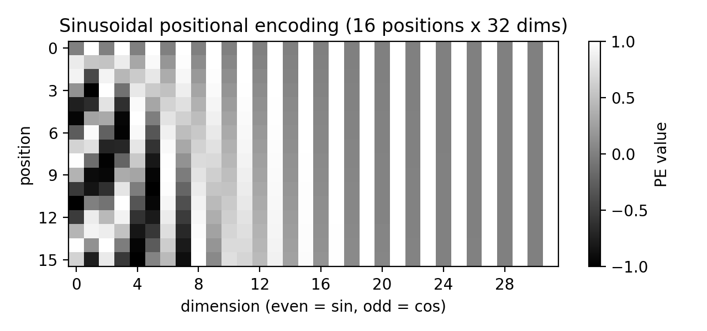
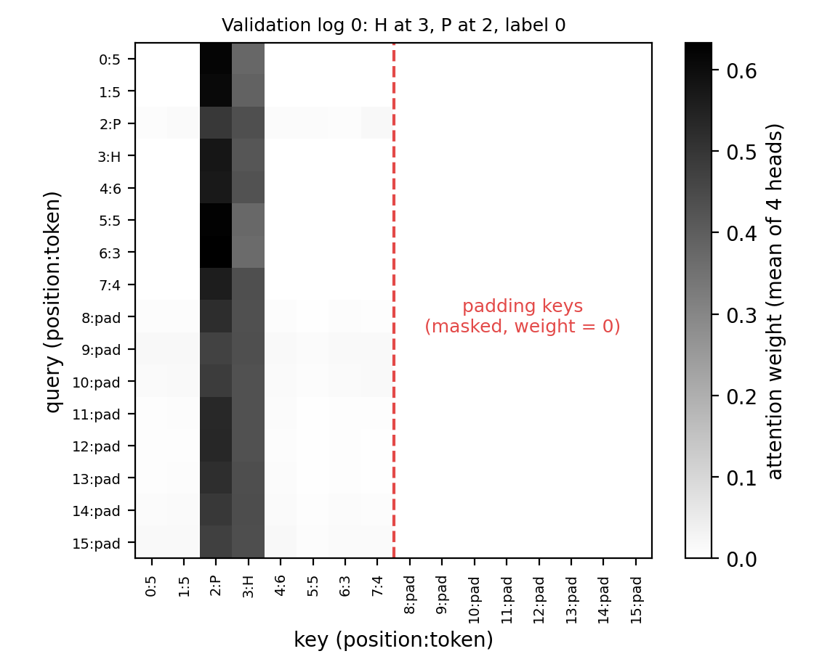
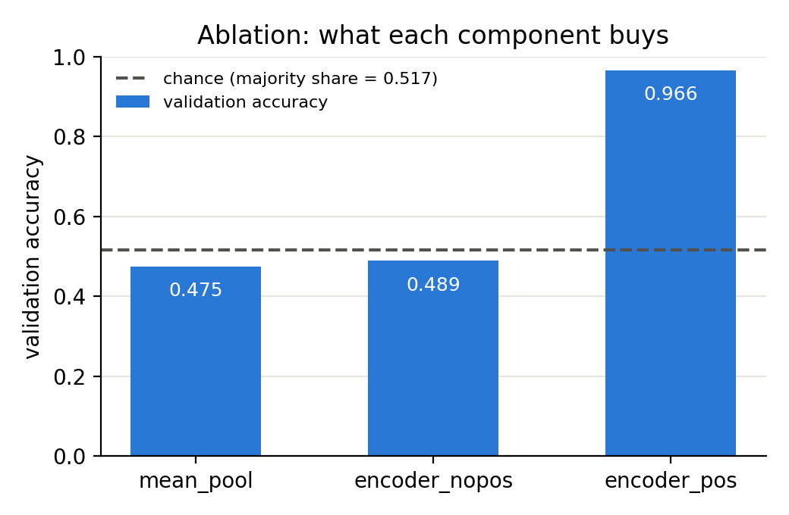

# Lab 7 Report — 20201068 이지호

## 1. What I did

스켈레톤의 고정 조건(분할, 시드 42, 12 epoch, batch 64, lr 3e-3)은 그대로 두고 TODO 4개만 구현했다. 위치 인코딩은 float64로 계산한 뒤 float32로 변환했다. 구현을 확인하기 위해 같은 가중치를 복사한 `F.scaled_dot_product_attention`, `nn.MultiheadAttention`, `nn.TransformerEncoderLayer`(post-norm, dropout 0)와 출력을 비교했고 차이는 1e-5 미만이었다(제출 코드에는 이 모듈들을 쓰지 않음). 또 모든 검증 로그에서 열 알람과 압력 알람의 위치를 맞바꾸는 대칭성 검사를 따로 했다(§4).

## 2. Results

**Table 1. Three configurations, one dataset, one seed, one training recipe.** 행마다 바뀌는 것은 attention 사용 여부와 위치 인코딩 사용 여부, 두 플래그뿐이다. 데이터 분할(학습 3,000 / 검증 1,000), 임베딩, masked-mean 풀링, 분류 헤드, 옵티마이저와 시드는 세 행 모두 같다.

| Configuration | Attention | Positional encoding | Val accuracy | Val loss |
|---------------|-----------|---------------------|--------------|----------|
| `mean_pool` | no | no | 0.4750 | 0.7017 |
| `encoder_nopos` | yes | no | 0.4890 | 0.6999 |
| `encoder_pos` | yes | yes | **0.9660** | **0.1396** |

검증 세트의 양성 비율은 0.517이므로 최빈 클래스로 찍을 때의 정확도(chance)는 0.517이다. `pe_gap`(= `encoder_pos` − `encoder_nopos`)은 0.477이다. `python src/lab07.py`를 두 번 실행했을 때 `runtime_seconds`를 제외한 모든 값이 같았다.

## 3. Figures

{.w78}

**Figure 1. The positional encoding matrix.** 세로축은 위치 0–15, 가로축은 차원 0–31이다(짝수 열은 sin, 홀수 열은 cos). 각 열은 위치에 대한 매끄러운 함수이므로 인접한 행은 비슷하고, 멀리 떨어진 행은 왼쪽의 빠르게 진동하는 열에서 달라진다. 16번 이후 차원은 주기가 2π·100 이상이라서 16칸 안에서는 거의 상수(sin≈0, cos≈1)다.

{.w58}

**Figure 2. Attention weights for one validation log.** 검증 로그 0번(실제 이벤트 8개, 압력 알람이 위치 2, 열 알람이 위치 3, 레이블 0)에 대해 학습된 `encoder_pos` 모델의 attention을 4개 헤드 평균으로 그렸다. 행은 query, 열은 key이다. 실제 이벤트인 query는 모두 P 열(0.49–0.63)과 H 열(0.37–0.44)에 가중치를 몰아준다. 패딩 key 열 8–15의 가중치는 정확히 0이다(측정 최댓값 0.0).

{.w58}

**Figure 3. Validation accuracy of the three configurations.** 점선은 chance 수준(검증 세트 최빈 클래스 비율 0.517)이다. `mean_pool`(0.475)과 `encoder_nopos`(0.489)는 이 선보다 아래에 있고, `encoder_pos`(0.966)만 크게 넘는다.

## 4. Interpretation

**chance 근처의 두 설정은 학습 실패가 아니라 구조적 한계다.** `mean_pool`은 임베딩의 평균이고, `encoder_nopos`는 위치 정보 없이 attention을 거친 뒤 평균을 낸다. self-attention은 순열에 대해 등변이고, 그 뒤의 평균은 순열에 대해 불변이다. 따라서 두 모델 모두 이벤트의 순서가 아니라 토큰의 다중집합만 보는 함수다. 실제로 모든 검증 로그에서 H와 P의 위치를 맞바꿔 보니 `encoder_nopos`의 logit 차이는 최대 6×10⁻⁸(부동소수점 오차)이었다. 다중집합은 같고 레이블만 반대인 두 입력에 같은 답을 내야 하므로, 어떤 가중치를 써도 약 50%를 넘을 수 없고 학습을 더 해도 달라지지 않는다. 검증 loss 0.70 ≈ ln 2 = 0.693은 두 모델이 사실상 0.5만 출력한다는 뜻이다. chance보다 약간 낮은 정확도는 학습 세트의 우연한 다중집합 상관을 외운 결과로 보인다(Table 1, Figure 3).

**위치 인코딩이 바꾸는 것.** 각 위치의 임베딩에 서로 다른 벡터 PE[p]를 더하면(Figure 1) 같은 토큰도 위치에 따라 다른 입력이 된다. 즉 embed(H)+PE[3] ≠ embed(H)+PE[2]가 되어 모델이 순서에 민감한 함수가 된다(같은 맞바꾸기 검사에서 초기화 직후 logit 차이가 1×10⁻²). Figure 2에서 모든 query가 두 알람 key에 가중치를 집중하는 것이 이 정보를 쓰는 방식이다. 검증 세트 전체에서도 실제 query가 받는 attention의 91.9%가 두 알람 위치로 간다. 그 key/value에는 알람의 위치가 PE로 섞여 있으므로, 풀링된 벡터에 "어느 알람이 앞에 있는가"가 담기고 헤드가 그것을 읽는다. 블록 하나만으로 0.477의 차이가 나는 이유다.

**마스크.** Figure 2에서 패딩 key 열은 모든 query에 대해 정확히 0이고 각 행의 합은 1이다(0.9999999–1.0000001). softmax 전에 점수를 −∞로 바꾸기 때문에 기대한 그대로다. 패딩 위치의 query 행(8–15)도 실제 key에 가중치를 주지만, 이 행들의 출력은 `masked_mean`에서 버려진다.

**√d_k로 나누는 이유.** 성분이 서로 독립이고 분산이 1이면 q·k의 분산은 d_k이므로 점수의 표준편차는 √d_k로 커진다. √d_k로 나누면 점수가 단위 스케일로 돌아오고, softmax가 포화되지 않아 기울기(∝ p(1−p))가 살아 있다. 이 나눗셈을 빼면 d_k = 8인 이 랩에서는 점수가 2.83배 커진다. 그러면 초기부터 attention이 한두 칸에 쏠리고 loss가 더 느리고 불안정하게 줄어들 것으로 예상한다. d_k가 64 이상이면 attention이 거의 one-hot이 되어 기울기가 사라지고 loss가 정체될 것이다. 이 부분은 실험으로 확인하지 않은 예상이다.

## 5. Limitations

모든 로그가 16칸 이하이므로 검증 세트의 알람 위치는 학습 중에 이미 본 위치다. 테스트 로그가 학습 때보다 길어서 알람이 처음 보는 위치에 나타나면, 절대 위치를 표현하는 사인 인코딩이 그 위치에서도 순서 비교를 일반화한다는 보장이 없다. 그러면 0.966이라는 결론은 깨질 수 있고, 상대 위치 방식이 필요할 수 있다. 또 결과는 시드 하나, 분할 하나에서 나왔으므로 `mean_pool`과 `encoder_nopos`의 0.014 차이는 잡음 범위다.

## AI & external-code usage

| Tool / Source | Part used for | What I modified & verified myself |
|---------------|---------------|-----------------------------------|
| Claude Code (Anthropic, Claude Opus 5.5) | Task 1–4 구현 코드, 노트북 그림 셀 3개, 대조 검사 스크립트, 리포트 초안과 README 작성, 제출 zip 구성 | 공개 테스트 6/6 통과, PyTorch 내장 모듈과의 출력 비교(차이 < 1e-5), 두 번 실행 시 결과 동일, 마스크된 가중치 0.0 확인 |
| Vaswani et al. (2017); 과제 개념 노트 | 위치 인코딩 식, post-norm 순서 | 스켈레톤 docstring의 명세와 대조 |
