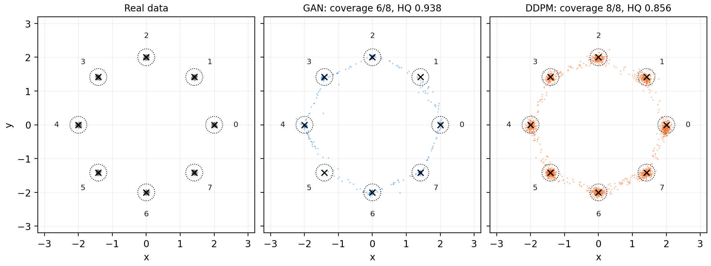
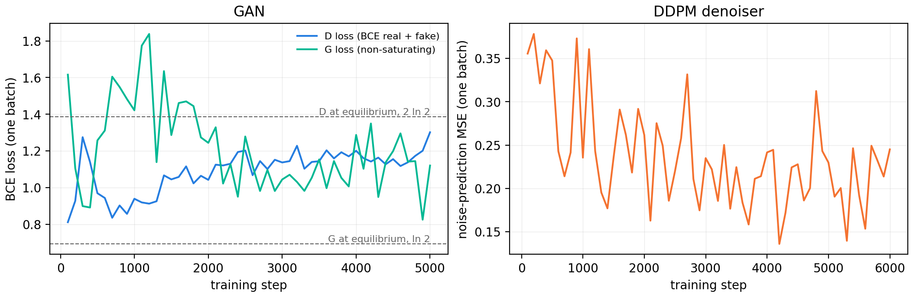
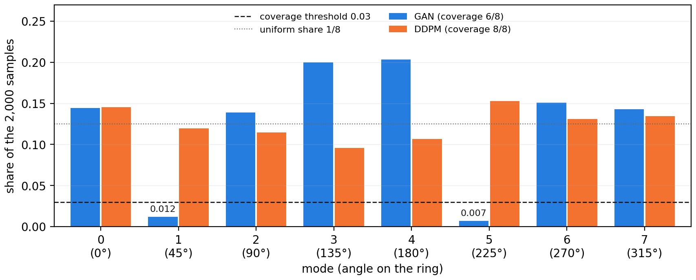

# Lab 9 Report — 20201068 이지호

## 1. What I did

I implemented the four TODO blocks exactly as the docstrings specify, with no private helpers. The GAN's
sampling time includes drawing its latent `z`, just as DDPM's time includes its own noise draws. As an
extra check outside `src/` (it is not in `results.json`), I re-ran `run_experiment` with five more RNG
seeds for Table 2. Everything ran on Python 3.10.21, torch 2.14.1+cpu and numpy 1.26.4.

## 2. Results

**Table 1. Both generative models under identical data, seed, and evaluation.** My interpretation rests
on the first two rows: each family wins one of them.

| Metric | GAN | DDPM |
|--------|-----|------|
| Mode coverage (of 8) | 6 | 8 |
| High-quality fraction | 0.9375 | 0.8560 |
| Smallest mode share | 0.007 (mode 5) | 0.0955 (mode 3) |
| Sampling wall-clock for 2,000 samples (s) | 0.0006 | 0.1138 |
| Network passes per sample | 1 | 100 |
| Final training loss(es) | D: 1.3018 / G: 1.1204 | 0.2450 |

**Table 2. Varying only the RNG seed (batch order, noise, sampling).** Initial weights stay fixed by
`set_seed(42)`. Seed 42 is the run in `results.json`.

| RNG seed | 42 | 0 | 1 | 2 | 3 | 4 |
|----------|----|---|---|---|---|---|
| GAN coverage / HQ | 6 / 0.938 | 5 / 0.934 | 7 / 0.937 | 7 / 0.911 | 5 / 0.921 | 5 / 0.933 |
| DDPM coverage / HQ | 8 / 0.856 | 8 / 0.845 | 8 / 0.869 | 8 / 0.866 | 8 / 0.872 | 8 / 0.860 |

## 3. Figures

<figure>
<figcaption><strong>Figure 1. Real data vs GAN samples vs DDPM samples.</strong> Crosses mark the true
centers, dotted circles the 0.25 high-quality radius, and the numbers are mode indices. The GAN produces
modes 0, 2, 3, 4, 6 and 7 as tight clusters and leaves crosses 1 and 5 almost bare. DDPM produces all
eight, but with wider clusters and more points on the ring between modes.</figcaption></figure>

<figure>
<figcaption><strong>Figure 2. Training loss curves</strong> (one minibatch per point, every 100 steps). The D
loss stays below its equilibrium value 2 ln 2 and the G loss above ln 2 (dashed), and neither settles. The DDPM loss falls noisily from about 0.31 to
about 0.21 and is still falling at step 6,000. Neither panel shows which modes are produced.</figcaption></figure>

<figure class="narrow">
<figcaption><strong>Figure 3. Per-mode sample share.</strong> Only GAN bars fall below the 0.03 threshold:
mode 1 (0.012) and mode 5 (0.007). Meanwhile modes 3 and 4 each take 0.20 of the GAN's samples. All eight
DDPM bars lie between 0.0955 and 0.153.</figcaption></figure>

## 4. Interpretation

**The two metrics reward different things, and each family wins one** (Table 1). Coverage only asks
whether a mode gets at least 3% of the samples. The high-quality (HQ) fraction only asks whether a sample
lands near *some* center, so a generator that puts every sample on a single mode would score HQ = 1.0 with
coverage 1. The GAN's HQ of 0.9375 comes from clusters as tight as the data: HQ samples sit on average
0.040 from their center, against 0.038 for the real points. Its coverage of 6 comes from moving the mass
of modes 1 and 5 to their neighbours, which is why modes 3 and 4 each hold about 0.20 (Figure 3). DDPM's
HQ samples sit 0.106 from their center, almost three times as spread, and 14.4% of its samples miss every
circle against the GAN's 6.25% (Figure 1). Over 94% of the misses of both models lie on the ring
(|r − 2| < 0.25), *between* modes. For the GAN, these misses are the price of a continuous map from one
connected Gaussian onto eight separate islands. For DDPM, they are reverse chains that had not yet settled
on a mode. Its loss was still falling when training stopped (Figure 2), so the denoiser has not resolved
the 0.03-wide modes. DDPM keeps every mode because its loss is a regression over *every* training point
at every noise level. A mode it ignored would raise the MSE in every batch. The GAN generator, by
contrast, only gets gradients where its own samples are. Once no fake lands near mode 5, nothing in its
loss pulls samples back there.

**I could not have predicted coverage from the loss curves.** The D loss drifts from 0.96 (mean of the
first ten logged points) to 1.17 (last ten), towards 2 ln 2 = 1.386. The G loss falls from 1.31 to 1.13.
That looks like a healthy, near-balanced game, yet two modes are missing (Figure 2). The DDPM loss
(0.307 → 0.206) is averaged over all timesteps and all modes. It says the denoiser is still improving,
not where the samples land. Only the sample-based metrics expose the mode dropping.

**DDPM pays for coverage at sampling time.** The GAN maps all 2,000 latents to samples in one forward
pass. `ddpm_sample` runs the `for t = 99 … 0` loop, and each step is a full `DenoiseNet` pass over all
2,000 points. The steps cannot run in parallel, because xt−1 needs xt. That is 100
passes per sample, and 0.1138 s against 0.0006 s of wall-clock (≈190×). The ratio is larger than 100
partly because `DenoiseNet` is bigger (17,794 parameters against 1,218 for `GenNet`) and partly because of
per-step overhead. A 0.6 ms reading is also close to timer noise, so the ratio is only rough.

**Doubling `MODE_SHARE_MIN` to 0.06 changes nothing.** The GAN's missing modes (0.012, 0.007) are far below
both thresholds, and DDPM's smallest share (0.0955) is above even 0.09. So the coverage gap is not an
artifact of where the threshold sits.

## 5. Limitations

Everything rests on one weight initialization and one training budget. Table 2 varies only the RNG seed.
Across those six runs the GAN covers 5 to 7 modes and never all 8, DDPM covers all 8 every time, and the
GAN's HQ (0.911–0.938) stays above DDPM's (0.845–0.872). So the *direction* holds, but "the GAN drops
two modes" is one draw from a range of 5 to 7. The budget could change the quality verdict. DDPM's loss
is still falling, so more denoiser steps would probably tighten its clusters and close part of the HQ
gap. This toy shows the trade-off on known 2D modes, not its size on real data, where neither metric can
even be computed without the true centers.

## AI & external-code usage

| Tool / Source | Part used for | What I modified & verified myself |
|---------------|---------------|-----------------------------------|
| Claude Code (Anthropic, model Claude Opus 5.5) | Implementing Tasks 1–4 in `src/lab09.py`; the three notebook plot cells; the extra seed sweep and statistics behind Table 2 and §4; drafting this report and `README.md` | Ran `pytest tests/` (6/6 pass); ran `src/lab09.py` twice and confirmed every non-wall-clock metric is identical; ran `check_submission.py`; checked every number in Tables 1–2 and §4 against `results.json` and a re-run. |
